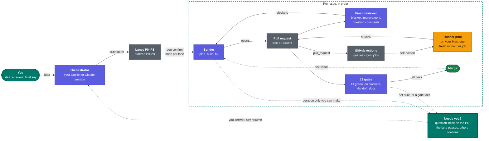

# amplifactory

**A [Copier](https://copier.readthedocs.io/) template for an issue-driven agent factory on GitHub Copilot or Claude Code.**

📖 **Documentation:** https://rahmansunny071.github.io/amplifactory/, built from [`docs/`](docs/index.md)

You plan with an agent: an idea becomes prioritized lanes of ordered GitHub issues. Then the factory takes each issue from plan to merged PR: a builder plans, builds and fixes, a fresh reviewer checks the work, and the orchestrator merges when the gates pass (by default Claude Opus orchestrates and reviews, and Claude Sonnet builds). When it needs you, it asks on the PR and keeps working. Every generated repo gets this process, with two ways to run it: the interactive **`factory` skill** in GitHub Copilot (the CLI or the app) or Claude Code (recommended), and an optional, async **GitHub Actions mode** (off unless you generate with `--data actions_agent=copilot` or `claude`). Either way you stay the only one who can start work, approve it, merge to `main` or publish.



*Blue: agents. Grey: GitHub. Amber: CI on the runner pool on your Mac. Teal: you. Dotted lines: when it needs you, and the next issue.*

## Quickstart

You need Python 3.9 or newer (the skill's scripts run as `python3`), [uv](https://docs.astral.sh/uv/), git, the [GitHub CLI](https://cli.github.com/) (`gh`, logged in), and [GitHub Copilot](https://docs.github.com/copilot/how-tos/copilot-cli) (the CLI or the app) or [Claude Code](https://claude.com/claude-code). The [Quick start](docs/getting-started/quick-start.md) walks this path on one small project, with the output you should see.

```bash
uvx copier copy gh:rahmansunny071/amplifactory my-project   # 1. answers a few questions
cd my-project
gh auth refresh -h github.com -s repo,workflow,project       # 2. gh scopes
./scripts/bootstrap.sh --private                             # 3. or --public; EMU work accounts can only use --private
copilot                                                      # 4. or claude; on the orchestrator model, then the factory skill
```

`bootstrap.sh` creates and pushes the GitHub repo, the labels, the "Documentation tech-debt" issue, a Project board and a ruleset protecting `main` (rulesets need a public repo or GitHub Pro; EMU work accounts can only use `--private`). From step 4 the skill works and needs no secret. Say "brainstorm X into issues", then "run the factory".

**Optional, last: the Actions mode.** It's off by default: generate with `--data actions_agent=copilot` or `--data actions_agent=claude`, or add it later with `uvx copier update --data actions_agent=…`. With `copilot`, its agents are the GitHub Copilot CLI, signed in with each workflow's own token: no secret, billed to your Copilot seat, and on your Mac's runner pool where GitHub-hosted runners are off (after adding it with `copier update`, run the command the update prints, which lets workflows open pull requests). With `claude`, they are Claude Code GitHub Actions, which need a Claude subscription: in Claude Code, once per repo, `/install-github-app`, pick the repo, choose your subscription, then close the installer's PR. If it fails on the `workflow` scope, see [Troubleshooting](docs/reference/troubleshooting.md). [The Actions mode](docs/concepts/actions-mode.md) explains both.

To let the skill merge PRs itself you can opt in with a permission rule; the one canonical copy is in [Flag and continue: Ready to merge](docs/concepts/flag-and-continue.md#ready-to-merge). The template does not ship it.

## Learn more

- **Get started:** [Quick start](docs/getting-started/quick-start.md), [Create a project](docs/getting-started/create-a-project.md) (including what a generated repo contains), [Your first run](docs/getting-started/first-run.md)
- **Concepts:** [Lanes and priorities](docs/concepts/lanes.md), [The pipeline](docs/concepts/pipeline.md), [Flag and continue](docs/concepts/flag-and-continue.md), [Real data](docs/concepts/real-data.md), [Docs ship with the code](docs/concepts/docs-with-code.md), [Where knowledge lives](docs/concepts/where-knowledge-lives.md), [Lessons](docs/concepts/lessons.md), [The GitHub Actions mode](docs/concepts/actions-mode.md)
- **Guides:** [Day-to-day](docs/guides/day-to-day.md), [Copilot and Claude Code](docs/guides/copilot-and-claude.md), [Adopt in an existing repo](docs/guides/adopt-in-existing-repo.md), [Keep up to date](docs/guides/keep-up-to-date.md), [Evolving the template](docs/guides/evolving-the-template.md)
- **Reference:** [Copier questions](docs/reference/questions.md), [Scripts](docs/reference/scripts.md), [Merge gates](docs/reference/gates.md), [Labels](docs/reference/labels.md), [Guardrails](docs/reference/guardrails.md), [Troubleshooting](docs/reference/troubleshooting.md), [`CHANGELOG.md`](CHANGELOG.md)

## Developing the template

The documentation site is built from `docs/` with MkDocs Material (`uvx --with mkdocs-material mkdocs serve`) and published by `.github/workflows/docs.yml`. Template files live in `template/`; files ending in `.jinja` are rendered. `.github/workflows/template-ci.yml` defines the template checks (render each variant, run the generated project's checks, assert every guardrail is present). It runs on GitHub-hosted runners, and `scripts/check.sh` runs it locally.

```bash
uvx copier copy --defaults --vcs-ref HEAD --data project_name=demo --data "description=Demo." . /tmp/demo
```

Without `--vcs-ref HEAD`, Copier renders the latest tag, not your working tree.

Created by **[Sajjadur Rahman](https://sajjadur.net/)**.
