# Lessons

A **lesson** is a factory problem written down where it can be fixed: an issue labelled `lesson` in
`rahmansunny071/amplifactory`. Every project the template made shares the same skills, briefs and gates, so
one fix there reaches all of them.

```mermaid
%%{init: {"themeCSS": ".node.you .nodeLabel, .node.you .nodeLabel p, .node.agent .nodeLabel, .node.agent .nodeLabel p, .node.gh .nodeLabel, .node.gh .nodeLabel p, .node.done .nodeLabel, .node.done .nodeLabel p { color: #fff !important; } .flowchart-link { stroke: var(--md-mermaid-edge-color) !important; } .marker { fill: var(--md-mermaid-edge-color) !important; stroke: var(--md-mermaid-edge-color) !important; } .edgeLabel, .edgeLabel p { background-color: var(--md-mermaid-label-bg-color) !important; color: var(--md-mermaid-label-fg-color) !important; }"}}%%
flowchart LR
    proj["<b>Your project</b><br/>the factory does something wrong"]:::you
    skill["<b>factory-lesson</b><br/>drafts, checks for private data,<br/>asks you once"]:::agent
    lesson["<b>lesson issue</b><br/>in rahmansunny071/<br/>amplifactory"]:::gh
    release["<b>Release</b><br/>release PR closes the lesson;<br/>tag vX.Y.Z"]:::gh
    sync["<b>sync-root-factory</b><br/>PR in every project"]:::agent
    fixed(["<b>Fixed everywhere</b>"]):::done

    proj -->|"file a factory lesson: ..."| skill
    skill --> lesson
    lesson --> release
    release --> sync
    sync -->|"you merge"| fixed
    fixed -.->|"next run"| proj

    classDef you fill:#00796B,stroke:#004D40,color:#fff,stroke-width:2px
    classDef agent fill:#5C5CE0,stroke:#3D3DB8,color:#fff
    classDef gh fill:#57606A,stroke:#30363D,color:#fff
    classDef done fill:#1A7F4B,stroke:#0F5132,color:#fff
```

## What counts

A lesson is about the **factory**, not your project's code:

- a default, question or message in the template that was wrong or misleading;
- a skill step, brief or gate that made an agent do the wrong thing, or blocked a good PR;
- a script (`queue.py`, `lanes.py`, `bootstrap.sh`, the runner pool) that failed on realistic input.

A bug in your project is an ordinary issue in your project.

## File it when it happens

Say it in the session where you hit it:

> file a factory lesson: the builder skipped the Docs line in the Handoff

The `factory-lesson` skill finds the template from `_src_path` in `.copier-answers.yml`, searches the `lesson` issues
for a duplicate, drafts the body (what happened with links, the fix you applied in the project, the template files to
change), checks it for real data, secrets and private paths, and asks you **once**. It files in the template's repo. It
never files in your project. How it picks the repo:
[Keep up to date](../guides/keep-up-to-date.md#file-a-factory-problem-upstream).

Fix the problem in your project first if you can: the lesson records the fix, so the template change is small.

## How it reaches you

1. A release PR (`release/vX.Y.Z`) closes the lessons it fixes and adds a changelog entry for each. See
   [Evolving the template](../guides/evolving-the-template.md).
2. After the tag, say "sync the factory to the latest release" in your project. `sync-root-factory` opens a PR with the
   update; you merge it. Or run `uvx copier update`. See [Keep up to date](../guides/keep-up-to-date.md).

A lesson the template already fixed is answered with the fixing release and the update command, not a new issue.
