# Local CI

Some accounts can't use GitHub-hosted runners (EMU personal repos, for one), so a generated repo's CI
never starts. The **runner pool** runs that CI on your Mac instead: one pool per Mac, serving every factory repo
on it, with a fresh runner for each job.

**Do you need it?** Only when GitHub-hosted runners are off for your account. The first "run the factory" in a repo
checks this and offers the setup. Otherwise skip this page.

## Do this

| Goal | Where |
|---|---|
| Put a repo's CI on the pool | [Local CI setup](../guides/local-ci-setup.md), or say "set up CI runners" |
| Check that the pool works | `python3 .claude/skills/factory-ci/scripts/setup.py doctor` |
| A job waits forever, the pool is down, Docker isn't running | [Troubleshooting](../reference/troubleshooting.md) |
| Every `runners.py` and `setup.py` flag | [Scripts](../reference/scripts.md#runnerspy) |
| Fair share, caches, container and security details | [Runner pool details](../reference/runner-pool.md) |

## How a job reaches the pool

```mermaid
%%{init: {"themeCSS": ".node.you .nodeLabel, .node.you .nodeLabel p, .node.agent .nodeLabel, .node.agent .nodeLabel p, .node.gh .nodeLabel, .node.gh .nodeLabel p, .node.done .nodeLabel, .node.done .nodeLabel p { color: #fff !important; } .node.ci .nodeLabel, .node.ci .nodeLabel p { color: #1F1300 !important; } .flowchart-link { stroke: var(--md-mermaid-edge-color) !important; } .marker { fill: var(--md-mermaid-edge-color) !important; stroke: var(--md-mermaid-edge-color) !important; } .edgeLabel, .edgeLabel p { background-color: var(--md-mermaid-label-bg-color) !important; color: var(--md-mermaid-label-fg-color) !important; } .cluster-label .nodeLabel, .cluster-label p { color: var(--md-mermaid-label-fg-color) !important; }"}}%%
flowchart LR
    push(["<b>Push or PR</b><br/>to a factory repo"]):::gh
    queue["<b>GitHub queues the job</b><br/>runs-on: self-hosted,<br/>factory-run-RUN_ID"]:::gh
    subgraph mac["Your Mac"]
        direction LR
        pool["<b>Pool service</b><br/>login service; polls the<br/>queue of each repo"]:::ci
        share["<b>Free slot?</b><br/>fair share across repos,<br/>then PRs, P0 first.<br/>No: the job waits"]:::ci
        runner["<b>Fresh runner</b><br/>copy of the base install,<br/>or a container"]:::ci
        log["<b>Cleanup</b><br/>runner deleted, one line<br/>in jobs.jsonl"]:::ci
    end
    check(["<b>Check on the PR</b><br/>pass or fail"]):::done

    push --> queue
    queue -->|"seen by"| pool
    pool --> share
    share -->|"asks for a just-in-time<br/>runner with those labels"| runner
    runner -->|"takes that one job"| check
    runner -->|"then"| log

    classDef gh fill:#57606A,stroke:#30363D,color:#fff
    classDef ci fill:#F59E0B,stroke:#B45309,color:#1F1300,stroke-width:2px
    classDef done fill:#1A7F4B,stroke:#0F5132,color:#fff
    style mac fill:none,stroke:#F59E0B,stroke-width:2px,stroke-dasharray:6 4
```



With the repo variable `FACTORY_RUNNER=local`, the generated `ci.yml` asks for
`runs-on: [self-hosted, factory-run-<run_id>]` ([CI variables](../reference/ci-variables.md)). The pool, a login
service on your Mac, watches the queue of each registered repo and, for each queued job:

1. asks GitHub for a just-in-time runner with exactly those two labels;
2. starts it in a fresh copy of its base install (or in a container, see below);
3. lets it take that one job, then deletes it and logs one line to `jobs.jsonl`.

At most `slots` runners run at once. Free slots are shared fairly across repos, then across pull requests (P0 first).
Runs from forks never run locally.

## Operate the pool

```bash
R=.claude/skills/factory-ci/scripts/runners.py
python3 $R status                              # up, paused or down; slots; the queue
python3 $R pause --reason "a demo at 3"        # no new runners; running jobs finish
python3 $R resume
python3 $R stats --days 7                      # waits and run times, p50 and p95
python3 $R logs --run 123456                   # a run's runner logs
python3 $R config --slots 6 --battery half     # capacity; half the slots on battery
```

`status` makes no API call. Its exit code is 0 when up, 5 when paused and 3 when down (no heartbeat for 2 minutes).
By default the pool leaves your Mac 4 performance cores and 16 GB of RAM, at about 2 GB per slot, and starts
nothing while memory pressure is critical. Runners run at low priority, and the pool keeps the Mac awake while any
runner is alive.

## Container mode (optional)

Each job runs in its own Linux container (`ghcr.io/actions/actions-runner`, Ubuntu 24.04) instead of on your Mac as
you. It needs Docker Desktop, with about 2 GB of Docker's VM per slot.

```bash
S=.claude/skills/factory-ci/scripts/setup.py
python3 $S container check              # Docker, and its VM's size
python3 $S container on --yes           # pulls the image, restarts the pool
python3 $S container off --yes          # new jobs run on the Mac again
```

It covers the whole pool. Docker must be running, jobs start cold, and jobs that need Docker (`services:`,
`container:`) fail. The [Actions mode with Copilot](actions-mode.md#with-copilot)'s agent jobs don't run in
containers yet: keep the pool on the Mac while a repo uses that mode.

## Security in one paragraph

On the Mac, a job runs as you. Use the pool only for your own **private** repos. A job gets its own `HOME`, a short
environment allowlist and no `GH_TOKEN`, so your logins aren't picked up by accident, but that is not a boundary: it
can read your files. Container mode keeps your files and logins out of reach. Details:
[Runner pool details](../reference/runner-pool.md#security-model).

## Where things are

The pool home is `~/.amplifactory/runner-pool/` (`$FACTORY_RUNNER_POOL_HOME` overrides it): `config.json`, `logs/`,
`jobs.jsonl`, `heartbeat.json`, `paused.json` while paused, and shared caches in `cache/`. The login service is
`com.amplifactory.runner-pool`. To remove everything:
`python3 .claude/skills/factory-ci/scripts/setup.py service uninstall --purge --yes`.
