# The pipeline

The skill runs in **your GitHub Copilot or Claude Code session**, the orchestrator: it picks work, checks plans,
verifies findings and merges. Subagents do the heavy lifting.

| Role | Default model (Claude Code / Copilot) | Lifetime | Does |
|---|---|---|---|
| **Orchestrator** | `opus` / `claude-opus-5.5` (your session) | the run | queue, plan check, gates, merge, run log |
| **Builder** | `sonnet` / `claude-sonnet-5.5` | one per issue, **reused** for build and fixes | plan → build → fixes, keeps the PR's Handoff current |
| **Design reviewer** | `opus` / `claude-opus-5.5`, fresh | critical issues only | reviews the plan before any code |
| **Code reviewer** | `opus` / `claude-opus-5.5`, fresh | once per issue | inline findings while CI runs |

Change the models in the generated `CLAUDE.md` ("Models"). The skill's "Claude Code and Copilot" table maps each
action onto the harness's tools: the builder is reused with `SendMessage` in Claude Code, and in Copilot it is a
background agent messaged with `write_agent`.

## One issue, step by step

```mermaid
%%{init: {"themeCSS": ".node.you .nodeLabel, .node.you .nodeLabel p, .node.agent .nodeLabel, .node.agent .nodeLabel p, .node.gh .nodeLabel, .node.gh .nodeLabel p, .node.done .nodeLabel, .node.done .nodeLabel p { color: #fff !important; } .node.ci .nodeLabel, .node.ci .nodeLabel p { color: #1F1300 !important; } .flowchart-link { stroke: var(--md-mermaid-edge-color) !important; } .marker { fill: var(--md-mermaid-edge-color) !important; stroke: var(--md-mermaid-edge-color) !important; } .edgeLabel, .edgeLabel p { background-color: var(--md-mermaid-label-bg-color) !important; color: var(--md-mermaid-label-fg-color) !important; } .cluster-label .nodeLabel, .cluster-label p { color: var(--md-mermaid-label-fg-color) !important; }"}}%%
flowchart LR
    plan["<b>1. Plan</b><br/>design file and<br/>draft PR"]:::agent
    check["<b>2. Plan check</b><br/>you read it; critical issues<br/>get a design reviewer"]:::agent
    build["<b>3. Build</b><br/>code, docs, checks,<br/>Handoff, PR ready"]:::agent
    review["<b>4a. Fresh reviewer</b><br/>inline comments"]:::agent
    ci["<b>4b. CI</b><br/>on the runner pool<br/>or GitHub-hosted"]:::ci
    fix["<b>5. Fix</b><br/>same builder fixes blockers;<br/>you verify each one"]:::agent
    gates["<b>6. 13 gates</b><br/>on the PR's current commit"]:::agent
    merge(["<b>Merge</b><br/>next issue in the lane"]):::done
    ready["<b>factory:ready-to-merge</b><br/>you merge"]:::you
    ask["<b>Question on the PR</b><br/>the lane pauses"]:::you

    plan --> check --> build
    build --> review
    build --> ci
    review --> fix
    ci --> fix
    fix --> gates
    gates -->|"all pass"| merge
    gates -.->|"merge refused"| ready
    gates -.->|"a gate fails, not mechanical"| ask

    classDef you fill:#00796B,stroke:#004D40,color:#fff,stroke-width:2px
    classDef agent fill:#5C5CE0,stroke:#3D3DB8,color:#fff
    classDef ci fill:#F59E0B,stroke:#B45309,color:#1F1300,stroke-width:2px
    classDef done fill:#1A7F4B,stroke:#0F5132,color:#fff
```

1. **Plan.** The builder writes `.factory/designs/issue-N.md` (goal, approach, files and interfaces touched,
   dependencies, risks, tests) and opens a **draft PR** from `local/issue-N`.
2. **Plan check.** Standard issues: you read the plan. **Critical** issues (privacy or security code, a new
   dependency, a shared data contract, a public interface others build on) get a fresh design reviewer.
3. **Build.** The same builder implements, **updates the affected docs**, runs the checks from `CLAUDE.md` until
   green, fills in the PR's **Handoff** (including a **Docs** line: what was updated, or "none needed" and why) and
   marks it ready.
4. **Review ∥ CI.** A fresh reviewer checks the diff against the plan and `CLAUDE.md`, including that docs and code
   agree (see [Docs ship with the code](#docs-ship-with-the-code)). It posts **inline comments** tagged
   `[blocker]`, `[improvement]`, `[doc-debt]` or `[question]`; every blocker comes with a reproduction.
5. **Fix.** The builder fixes blockers. You verify each with its reproduction on the new commit and resolve the
   thread. There is no second full review.
6. **Gates and merge.** When all [thirteen gates](../reference/gates.md) pass, the factory merges (merge commit) and
   the lane moves on. If the merge is refused, it hands the PR to you (see [Ready to
   merge](flag-and-continue.md#ready-to-merge)).

## Real data

`CLAUDE.md` sets how far agents may read real data (`never` by default): see [Real data](real-data.md).

## Urgency triage

`CLAUDE.md` has a **Release phase** line. In **`mvp`** (until a first formal release), only **blockers** are fixed in
a PR:

- the main path breaks on realistic input;
- private data leaks on realistic input;
- a hard rule is violated;
- irreversible loss or overwrite of the user's existing data (source files, history, remote repos) on a plausible invocation, even a mistaken one, when a cheap guard would prevent it;
- a test falsely passes.

Everything else goes into **one `improvement` issue** per PR, usually in a hardening lane. Set the line to
**`hardening`** before a release, and reviews become thorough again.

## Docs ship with the code

Every code change brings its docs in the same PR: see [Docs ship with the code](docs-with-code.md).
