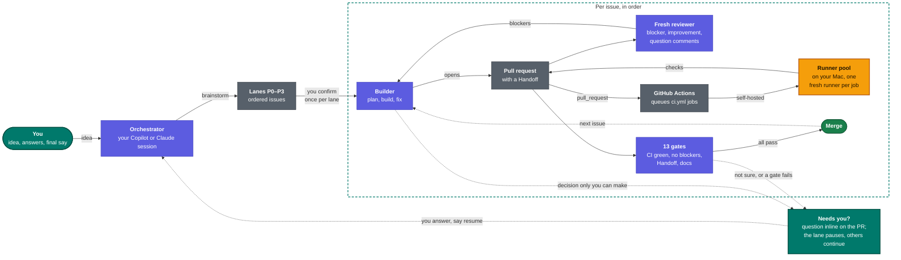

# amplifactory

amplifactory turns a repository into an **issue-driven agent factory**. In a GitHub Copilot or Claude Code
session (the **orchestrator**) you turn an idea into prioritized **lanes** of ordered GitHub issues. The factory then
takes each issue to a merged PR: a **builder** plans, builds and fixes, a fresh **reviewer** checks, and the
orchestrator merges when every gate passes. When it needs you, it asks on the PR and keeps working on other lanes.

It's a [Copier](https://copier.readthedocs.io/) template: one command creates a repo with the rules, the `factory`
skill, CI, labels, branch protection and a Project board. `copier update` brings in later releases.

*Blue: agents. Grey: GitHub. Amber: CI on the runner pool on your Mac. Teal: you. Dotted lines: when it needs you, and the next issue.*

## Get started

-   :material-flash-outline: **Quick start**

    ---

    One small CLI, from `copier copy` of the template to a merged PR with CI on your Mac's runner pool.

    [:octicons-arrow-right-24: Quick start](getting-started/quick-start.md)

-   :material-rocket-launch-outline: **Create a project**

    ---

    Generate a repo from the template, then run `bootstrap.sh` for the GitHub side: labels, branch protection and the Project board.

    [:octicons-arrow-right-24: Create a project](getting-started/create-a-project.md)

-   :material-play-circle-outline: **Your first run**

    ---

    Brainstorm into lanes, then say "run the factory" and watch the first issue go from plan to merge.

    [:octicons-arrow-right-24: Your first run](getting-started/first-run.md)

## What makes it work

| Idea | In short |
|---|---|
| [**Lanes and priorities**](concepts/lanes.md) | Features become lanes of ordered sub-issues; `P0`–`P3` and "blocked by" links set the schedule. |
| [**The pipeline**](concepts/pipeline.md) | One builder and one fresh reviewer per issue. Before a first release only blockers are fixed in the PR; the rest become `improvement` issues. |
| [**Flag and continue**](concepts/flag-and-continue.md) | Questions go on the PR with options and a recommendation. Answer whenever you like, then say "resume". |
| [**Real data**](concepts/real-data.md) | `never`, `with-approval` or `allowed`: how far agents may read real data. It is never committed or quoted. |
| [**Docs ship with the code**](concepts/docs-with-code.md) | Every code change brings its docs; the Handoff's Docs line is a merge gate. |
| [**Lessons**](concepts/lessons.md) | A factory problem found in your project becomes a `lesson` issue here, then a release, then an update in every project. |
| [**Copilot and Claude Code**](guides/copilot-and-claude.md) | Run the factory in either: setup, a model per role, what differs, and the Actions mode with each. |
| [**Keep up to date**](guides/keep-up-to-date.md) | `sync-root-factory` moves a repo to the latest release by PR; `factory-lesson` files factory problems in this repo. |
| [**Local CI**](concepts/local-ci.md) | One runner pool per Mac runs the CI of every factory repo on it, where GitHub-hosted runners are off. |
| [**Where knowledge lives**](concepts/where-knowledge-lives.md) | Issues, PRs, review threads, plans and Handoffs are the source of truth; the run log (`.factory/runs/`) and agent memory only point at them. |

## License

amplifactory is released under the [MIT License](https://github.com/rahmansunny071/amplifactory/blob/main/LICENSE). It covers the template; a project you generate is yours, under any license you choose (the template doesn't add one).
