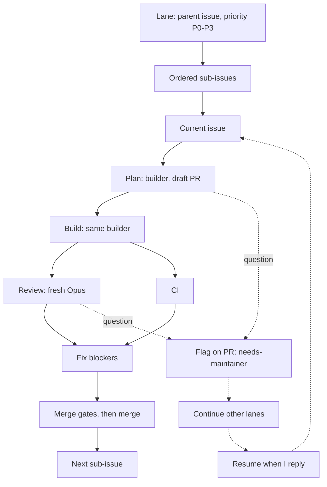

<!--
DRAFT for Substack. Not published by the docs site (lives outside docs/).
Alternate titles:
- I turned my agent workflow into a template
- What a real project taught my agent factory
Alternate subtitles:
- Issue-driven Claude Code, a Copier template, and the lessons from nine releases
- From label-by-label Actions to swim lanes: what broke and what I changed
Before publishing: settle every [link if public], [if public] and [verify] mark below, and export the mermaid diagram as an image.
-->

# Building an agent factory out of GitHub issues

*How a safe but slow label-driven workflow became a Copier template, got beaten into shape by a real project, and learned to run with me in the loop only by exception.*

I have been building something I now call agent-factory: a way to take a feature from idea to merged pull request using Claude Code agents, with GitHub issues as the only source of truth. This post is the story of how it got there. It is less about the final design than about the things that broke along the way, because the breakage is where all the useful decisions came from.

Repo: [link if public]. Docs: https://rahmansunny071.github.io/agent-factory/ [if public].

## The starting point: safe, and slow

The first version lived inside one project, convomem-arena, as a GitHub Actions factory driven by labels. You wrote an issue. You added a label, and an agent wrote a design. You read the design and added another label to approve it. An agent built it. Another agent reviewed it. You merged.

It was safe, and I do not want to undersell that. Nothing happened without my say-so. But I was the bottleneck at every single step. Each label was a context switch: open the PR, read, decide, click, wait, come back. The agents were fast and I was the slow part. A factory where the owner has to stand at every station is not much of a factory.

I wanted two things that pull in opposite directions: agents doing far more on their own, and me still able to trust what got merged.

## Making it a template

Before I could improve it, I had to stop it being a one-off. I turned it into a Copier template, so a new project could get the whole factory (workflows, agent prompts, issue template, CI, a package skeleton) with one command.

A few details turned out to matter more than I expected:

- **Different delimiters.** GitHub Actions uses `${{ }}` for expressions, and Copier's default Jinja delimiters collide with that. I switched the template to `[[ ]]`, so the workflow files survive rendering untouched.
- **`bootstrap.sh`.** One script sets up the labels, the `main` branch ruleset and the fork-PR approval setting. If that is a checklist in a README, it will be done wrong, so it is a script.
- **A template CI that renders real projects.** Every change to the template renders three variants of a project and runs their checks. A template that you cannot test is a template that quietly rots.

That was v0.1.0, generalized from the project I had been using. And then I did the obvious thing: I used it.

## A proving ground

You cannot design a factory in the abstract. I picked a real project, pensieve-traces (a tool that turns agent traces into datasets), and drove it through the template. It is public: you can read its issues and PRs [link if public].

The rule I set was simple. **Every factory problem becomes a `lesson` issue in the template repo, immediately.** Not a note in my head, not a fix in the project only. Then I batch the lessons into a tagged release, and projects pick the release up with `copier update`. That produced v0.1.1 through v0.5.0, and the lesson issues are still there as a record of what went wrong.

This is the loop I would recommend to anyone building tooling for agents: a real project that hurts, plus a place where the hurt is written down the moment it happens.

## What broke, and what it taught

Here is a sample of the early failures. Each one is now a guardrail.

**Bot-authored PRs were blocked, and the run still said "success".** The agent opens PRs as `claude[bot]`, and the action's `restrict_untrusted_prs` default blocked its own build step on them. The job went green. There was no artifact. Nothing had happened. The lesson was twofold: configure the bot allowlists on purpose, and treat "green but no artifact" as a failure, not a pass. The fix also needed a safety net, a build step that refuses design branches touching anything outside the designs folder, because relaxing a restriction should come with a guard.

**Stale merge refs.** A design PR opened before I changed a workflow kept running the *old* workflow, because GitHub tests the merge ref that existed when the PR was opened. And the reverse trap: a PR that changes a factory workflow skips that agent stage entirely, and still reports success. Both are now documented in the generated README under "Changing the factory itself": workflow changes go in their own PR, and open factory PRs get updated after one lands.

**A reviewer that invented scope.** This one taught me the most about agents. A reviewer suggested a cross-file merge, a plausible improvement nobody had asked for. The builder implemented it. It then broke in every following round, and each round's review found a new defect in it. Speculative scope from a reviewer is a bug factory. Now reviewers may not add scope they cannot verify; it becomes a question to me instead. And if two rounds find defects in the same area, the run stops and asks rather than looping.

**A rubric gap.** Later, a reviewer rubric did not treat irreversible data loss as a blocker. A plan that overwrites or deletes a user's files on a plausible, even mistaken, invocation is now a blocker whenever a cheap guard would prevent it (v0.5.1).

The common thread: agents are good at following a process and bad at noticing that the process itself is wrong. Everything that mattered was a rule I had to add after watching it fail.

## Opus reviews versus Sonnet reviews

The Actions factory used a Sonnet reviewer on every PR. For the first two pensieve issues I also ran an Opus reviewer from inside a Claude Code session, partly to compare.

Opus reproduced six defects that the Actions Sonnet review had called "Ready". Two of them were privacy leaks. They were caught before merge, on pensieve-traces issue #3, and I will not describe them further: the point is that the cheaper reviewer waved through exactly the kind of defect I most needed caught.

I do not want to turn this into "big model good, small model bad". I use Sonnet to build, because building is the high-volume step and it is good at it. But the reviewer is the one station where I want the strongest model, and where independence matters: a *fresh* reviewer that has not seen the builder's reasoning catches things the builder rationalized away. After that run, the weaker Actions review became redundant noise for the session-driven path, so the skill works on `local/issue-N` branches that the Actions review does not watch (v0.3.1).

## Cost and latency: where the money went

That same early run is where I looked at the bill. Two pensieve issues cost about 1.4M subagent tokens. Issue #2 alone was about 830k, with three design rounds and four code rounds [verify]. For two small issues, that is ridiculous.

Looking at why, it was three self-inflicted problems:

1. **Every finding was a blocker.** Reviewers raised a dozen small points, and every one was fixed and re-reviewed.
2. **Cold subagents.** Each step spun up a new agent that re-read the whole context. Ten to fifteen subagents per issue.
3. **Too many stages.** Design review, design re-review, code review, code re-review.

The fixes, shipped in v0.3.0, were boring and effective:

- **Urgency triage.** A `release_phase` setting (default `mvp`). In MVP, reviewers tag findings `blocker` or `improvement`. Only blockers are fixed in the PR. Everything else becomes one batched `improvement` issue, and the main path never depends on it. You ship the thing first and polish it later.
- **One builder, reused.** A single Sonnet builder plans, builds and fixes blockers, each as a message to the same agent, so it never re-reads context.
- **One fresh reviewer.** One Opus code reviewer, in parallel with CI. No re-review of blocker fixes: CI plus a repro check is enough.
- **Risk tiers.** Only critical issues (privacy, security, new dependencies, shared data contracts) get a separate design review. The rest get a skim.

That took an issue from 10-15 subagents to 2 or 3. A run log records cost and time per issue so I can see regressions instead of guessing at them.

## Human in the loop by exception

The label-driven version asked for me constantly. The goal now is the opposite: the factory asks only when it genuinely cannot proceed, and *never blocks while waiting*.

**Flag and continue** (v0.4.0). When a reviewer has a question, or a gate fails, or a data assumption cannot be verified, the agent posts it as an inline, line-anchored comment on the PR, with options and a recommendation. The issue gets a `needs-maintainer` label, and the run moves on to other work. When I come back I say "resume the factory", and it picks up from GitHub state: which waiting PRs have new replies from me.

**Handoffs in the PR.** The builder keeps a "Handoff" section in the PR body after each phase: what changed, key decisions, how to test, what is open. A replacement agent, or a fresh reviewer, starts from that instead of from nothing.

**Where knowledge lives.** I had to be strict about this. GitHub and the repo are the source of truth. The run log is a local cache and a cost ledger that only points at them. Claude's memory holds my preferences. If a fact is only in a chat or a log, it is lost.

## Swim lanes

Once single issues were cheap, the next bottleneck was planning. A flat backlog does not tell an agent what to do next. v0.5.0 introduced **swim lanes**: a lane is a parent issue whose native GitHub sub-issues run strictly in order. Lanes have priorities (`P0` to `P3`), and dependencies use GitHub's native "blocked by" links. One lane runs at a time unless I say otherwise, and merges are always one at a time.

Brainstorming is two-level: lanes first, then ordered issues in each lane, with only the next one or two written in full (rolling wave, because plans written too early go stale). Every brainstorm names a main path, the smallest chain that makes the thing work end to end, as the `P0` lane. Polish goes in a low-priority lane. On pensieve-traces, the work was restructured into four lanes this way, with a hardening lane blocked behind the end-to-end one.

_Export as an image for Substack._

## The release table

Here is the whole arc, one row per release. The pattern is that each row exists because something hurt.

| Release | Before | After |
|---|---|---|
| v0.1.0 | One project's Actions factory | A Copier template with bootstrap and template CI |
| v0.1.1 | Bot PRs blocked; green but no artifact | Allowlists, a design-branch guard, failures reported |
| v0.2.0 | Label by label, me at every step | `factory` skill: brainstorm, then run issues end to end |
| v0.3.0 | About 1.4M tokens for two issues | Urgency triage, one builder, one fresh reviewer |
| v0.3.1 | Actions review duplicated the skill's review | Skill uses `local/issue-N` branches |
| v0.4.0 | Agent waits on me; context lost between agents | Flag and continue, resume, PR handoffs |
| v0.5.0 | Flat backlog | Swim lanes, priorities, native dependencies, board |
| v0.5.1 | Data-loss risk only an "improvement" | Irreversible data loss is a blocker |
| v0.6.0 | Docs lagging code; merge refused by auto mode | Docs ship with the code; ready-to-merge hand-off |
| v0.7.0 | "Never read real data" hard-coded | Per-repo real-data level |
| v0.8.0 | Updating a repo was manual | `sync-root-factory` and `factory-lesson` skills |
| v0.9.0 | First real sync hit gaps | Sync runs the tag's own script; new skills arrive |

## The recent stretch, briefly

v0.6.0 through v0.9.0 were smaller but telling. A README on pensieve-traces still called a built feature "planned", so docs now ship in the same PR as the code, and a mismatch is a blocker even in MVP. Real-data access became a per-repo choice (`never`, `with-approval`, `allowed`) instead of a hard-coded ban, with a few rules that stay on regardless: never commit real data, never quote values from it. Two new skills close the loop on the template itself: `sync-root-factory` brings a repo up to the latest release, and `factory-lesson` files a factory problem as a lesson issue straight from the project that hit it. And the orchestrator now merges, and tags releases, on its own when the gates pass. I still read the PRs. I just no longer have to be the one clicking.

## What's next

The skill is Claude Code specific today, and that is a limitation I would like to remove. The next lane (#54) is generalizing the factory to GitHub Copilot and Codex, so the lanes, issues and gates work with whichever agent a team already uses. After that: measured runs on more pensieve issues, to check that the cost fixes hold, and applying the template back to convomem-arena, where it started.

The thing I keep relearning is that the process matters more than the model. The agents got better at their jobs only because I kept writing down what they got wrong, and turning each failure into a rule or a guardrail. If you try this, start with the lesson habit before anything else.

If you want to look at the mechanics: the docs are at https://rahmansunny071.github.io/agent-factory/ [if public] and the repo is [link if public].
